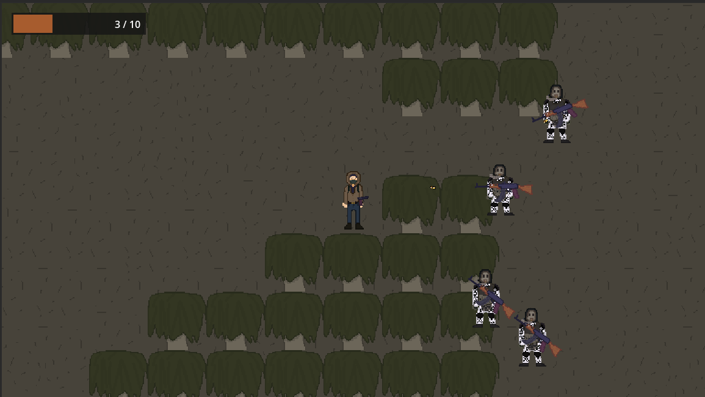
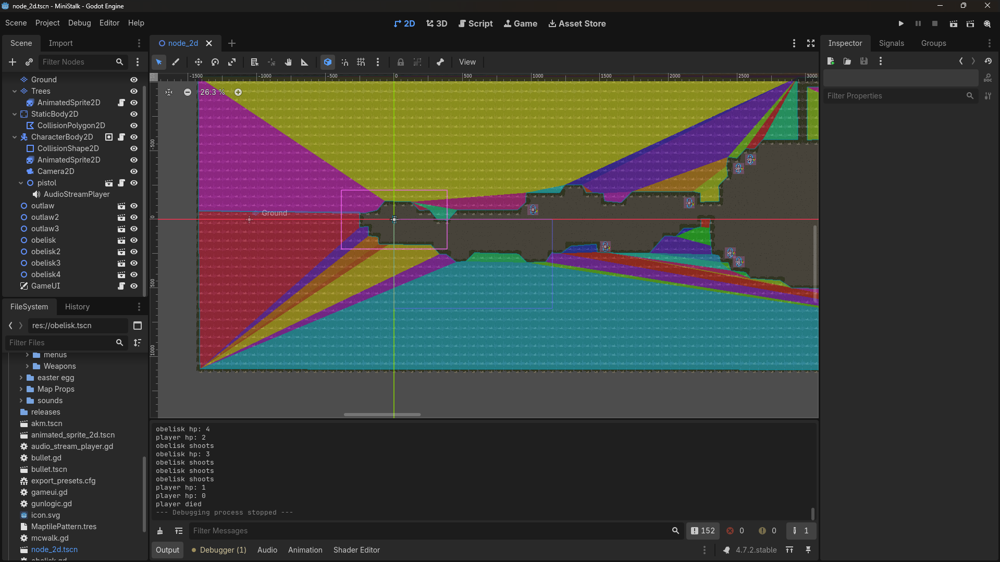
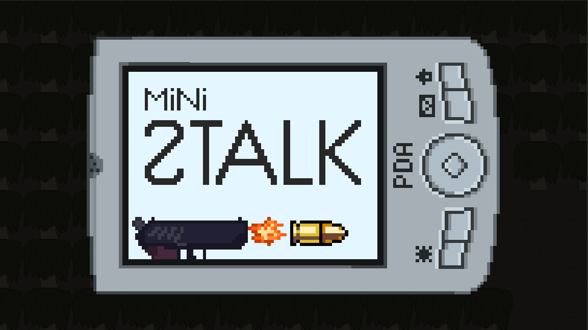

# ministalk

MiniStalk is a independent, free, open-source game inspired by post-apocalyptic sci-fi and the Chernobyl Exclusion Zone. This project is fan-made and is not affiliated with, endorsed by, or associated with GSC Game World.

ministalk is a game about exploring and fighting enemies in a wasteland, done all in godot, anyways so like we got ministalk which is like a lil demo or proof of concept and imo for my first time in godot im happy with it and so is the team insert yippie emoji.

you can play our game at: https://mimisol-1.itch.io/ministalk

here are some screenshots from the game:

Features:
- A simple movement system with WASD;
- A wheel inventory system that features two actual usable items: AI-2 kit and Stim (Bandage doesn't for giggles);
- Two kinds of enemies: The Outlaws that use a Makarov and The Obelisk that use an AKM and more strategic squad movement ai compared to Outlaws;
- A winning system for reaching the end of the map;
- A little path upstairs for no reason at all;

How to run it:
Go to the link mentioned above and click the RUN button to start the game since it runs on the web!

How it works:
So in short everything is in godot, we had like big dreams to shoot way above what we ended up having time to make it as what it ended up being, so we have an animated tree and the characters are aminated and there's bullets that move and like guns and such, all of it is just gdscript really, i used mimo the like ai model for a bit of help with the code cuz i had no experience with the game code, also the map is like tiles and i think thats about it really, oh yeah for the sprites we used libresprite, also lets us do animation s, we love libresprite <3

Credits:
-Oxy: developer for the gunplay, movement, AI for enemies and health bar
-Grand: UI designer, winning condition and voice actor for Outlaws
-JohnTarkov: Main sprite designer, particle effects, voice actor for the Obelisk and sound designer

thank you for your time :D

project directed by big man JohnTarkov himself (aura emoji)
